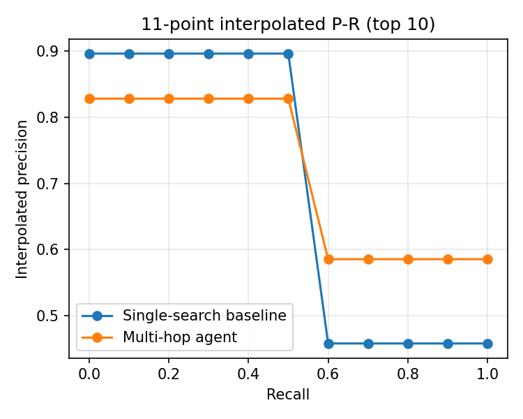

# HopSearch results

Corpus: 19225 paragraphs, 63569 terms. Dev questions: 200. Test questions: 500.

### E3a. Zone weighting (title vs body), DEV split

| System | n | R@2 | R@5 | R@10 | Both@2 | Both@5 | Both@10 | P@2 | MAP | nDCG@10 | ms/query |
|---|---|---|---|---|---|---|---|---|---|---|---|
| Agent, w_title=0.0 | 200 | 0.580 | 0.728 | 0.853 | 0.365 | 0.550 | 0.750 | 0.580 | 0.655 | 0.740 | 22.0 |
| Agent, w_title=0.2 | 200 | 0.627 | 0.787 | 0.877 | 0.420 | 0.640 | 0.770 | 0.627 | 0.712 | 0.789 | 22.6 |
| Agent, w_title=0.4 | 200 | 0.615 | 0.740 | 0.838 | 0.430 | 0.605 | 0.720 | 0.615 | 0.685 | 0.755 | 24.2 |
| Agent, w_title=0.6 | 200 | 0.580 | 0.690 | 0.767 | 0.415 | 0.565 | 0.650 | 0.580 | 0.644 | 0.705 | 25.4 |
| Agent, w_title=0.8 | 200 | 0.560 | 0.672 | 0.755 | 0.385 | 0.555 | 0.650 | 0.560 | 0.627 | 0.689 | 26.1 |

Chosen w_title = **0.2** (best Both@10 on dev).

### E5. Fusion of hop-1 and hop-2 results, DEV split

| System | n | R@2 | R@5 | R@10 | Both@2 | Both@5 | Both@10 | P@2 | MAP | nDCG@10 | ms/query |
|---|---|---|---|---|---|---|---|---|---|---|---|
| Agent chain fusion, alpha=0.3 | 200 | 0.625 | 0.780 | 0.877 | 0.420 | 0.630 | 0.770 | 0.625 | 0.709 | 0.787 | 22.7 |
| Agent chain fusion, alpha=0.5 | 200 | 0.627 | 0.787 | 0.877 | 0.420 | 0.640 | 0.770 | 0.627 | 0.712 | 0.789 | 22.5 |
| Agent chain fusion, alpha=0.7 | 200 | 0.625 | 0.785 | 0.877 | 0.415 | 0.635 | 0.770 | 0.625 | 0.710 | 0.788 | 22.5 |
| Agent RRF fusion | 200 | 0.468 | 0.740 | 0.905 | 0.180 | 0.530 | 0.820 | 0.468 | 0.596 | 0.716 | 22.6 |

Chosen alpha = **0.5**.

### E1. Main result: single search vs multi-hop agent, TEST split

| System | n | R@2 | R@5 | R@10 | Both@2 | Both@5 | Both@10 | P@2 | MAP | nDCG@10 | ms/query |
|---|---|---|---|---|---|---|---|---|---|---|---|
| Single-search baseline (tf-idf) | 500 | 0.585 | 0.747 | 0.853 | 0.262 | 0.518 | 0.716 | 0.585 | 0.673 | 0.772 | 3.8 |
| Multi-hop agent | 500 | 0.614 | 0.789 | 0.878 | 0.406 | 0.662 | 0.794 | 0.614 | 0.700 | 0.776 | 21.9 |

### E2. By question type, TEST split

| System | n | R@2 | R@5 | R@10 | Both@2 | Both@5 | Both@10 | P@2 | MAP | nDCG@10 |
|---|---|---|---|---|---|---|---|---|---|---|
| Baseline - bridge | 398 | 0.555 | 0.701 | 0.818 | 0.211 | 0.427 | 0.648 | 0.555 | 0.638 | 0.744 |
| Agent - bridge | 398 | 0.632 | 0.776 | 0.849 | 0.437 | 0.646 | 0.746 | 0.632 | 0.704 | 0.772 |
| Baseline - comparison | 102 | 0.701 | 0.926 | 0.990 | 0.461 | 0.873 | 0.980 | 0.701 | 0.810 | 0.882 |
| Agent - comparison | 102 | 0.544 | 0.838 | 0.990 | 0.284 | 0.725 | 0.980 | 0.544 | 0.686 | 0.792 |

Question-type detector accuracy vs HotpotQA labels: **0.926**

### E3b. Text-processing ablations (agent), TEST split

| System | n | R@2 | R@5 | R@10 | Both@2 | Both@5 | Both@10 | P@2 | MAP | nDCG@10 | ms/query |
|---|---|---|---|---|---|---|---|---|---|---|---|
| Full pipeline (stem + stop words removed) | 500 | 0.614 | 0.789 | 0.878 | 0.406 | 0.662 | 0.794 | 0.614 | 0.700 | 0.776 | 21.9 |
| No stemming | 500 | 0.608 | 0.776 | 0.874 | 0.402 | 0.644 | 0.788 | 0.608 | 0.692 | 0.770 | 19.9 |
| No stop-word removal | 500 | 0.615 | 0.783 | 0.872 | 0.404 | 0.658 | 0.784 | 0.615 | 0.703 | 0.777 | 75.4 |

### E4. Scoring function, TEST split

| System | n | R@2 | R@5 | R@10 | Both@2 | Both@5 | Both@10 | P@2 | MAP | nDCG@10 | ms/query |
|---|---|---|---|---|---|---|---|---|---|---|---|
| Single search, lnc.ltc | 500 | 0.585 | 0.747 | 0.853 | 0.262 | 0.518 | 0.716 | 0.585 | 0.673 | 0.772 | 4.3 |
| Single search, tf | 500 | 0.058 | 0.137 | 0.235 | 0.000 | 0.020 | 0.068 | 0.058 | 0.084 | 0.141 | 4.1 |
| Single search, jaccard | 500 | 0.368 | 0.505 | 0.608 | 0.098 | 0.242 | 0.368 | 0.368 | 0.413 | 0.515 | 16.5 |

### E6. Efficiency and net score, TEST split

| System | n | R@2 | R@5 | R@10 | Both@2 | Both@5 | Both@10 | P@2 | MAP | nDCG@10 | ms/query |
|---|---|---|---|---|---|---|---|---|---|---|---|
| Agent, full cosine scoring | 500 | 0.614 | 0.789 | 0.878 | 0.406 | 0.662 | 0.794 | 0.614 | 0.700 | 0.776 | 21.9 |
| Agent, Index elimination (idf >= 1.0, >= 2 terms) | 500 | 0.600 | 0.758 | 0.857 | 0.390 | 0.622 | 0.760 | 0.600 | 0.678 | 0.755 | 17.3 |
| Agent, Champion lists (r = 100) | 500 | 0.572 | 0.747 | 0.834 | 0.368 | 0.610 | 0.734 | 0.572 | 0.654 | 0.732 | 12.3 |
| Agent, Full + static quality g(d), lambda = 0.1 | 500 | 0.606 | 0.797 | 0.882 | 0.400 | 0.676 | 0.796 | 0.606 | 0.702 | 0.779 | 24.6 |

### E7. Failure analysis (agent, bridge questions, Both@10 = 0)

| Failure type | Count |
|---|---|
| hop 1 OK, but missing paragraph was not among bridge candidates | 94 |
| hop 1 found neither gold paragraph | 5 |
| bridge found, but ranked below top-10 after fusion | 2 |

Examples:

- **Which university did the third pick by the Philadelphia 76ers in the 2014 NBA draft attend before he was drafted?**  
  gold: ['2015–16 Philadelphia 76ers season', 'Joel Embiid']  
  hop-1 top-3: ['Joel Embiid', '2016–17 Philadelphia 76ers season', '1973 NBA draft']  
  bridges: ['Ben Simmons', 'Joel Embiid', 'University of Kansas']  
  category: hop 1 OK, but missing paragraph was not among bridge candidates
- **The Hong Kong Museum of Coastal Defence is located on an island with a population of what?**  
  gold: ['Hong Kong Island', 'Hong Kong Museum of Coastal Defence']  
  hop-1 top-3: ['Hong Kong Museum of Coastal Defence', 'Hong Kong Museum of Education', 'Hong Kong Science Museum']  
  bridges: ['Victoria Harbour', 'Victoria Harbour', 'Hong Kong Museum of History']  
  category: hop 1 OK, but missing paragraph was not among bridge candidates
- **What was the capacity of the stadium that Colección Privada that was filmed on October 10, 2000?**  
  gold: ['Colección Privada', 'Palacio de Deportes de la Comunidad de Madrid']  
  hop-1 top-3: ['Colección Privada', 'La Más Perfecta Colección', 'Kenneth P. LaValle Stadium']  
  bridges: ['Remixes', 'New York']  
  category: hop 1 OK, but missing paragraph was not among bridge candidates
- **Who is the television producer who created a 2011 American film based on a novel by Hunter S Thompson?**  
  gold: ['Colin Vaines', 'The Rum Diary (film)']  
  hop-1 top-3: ['The Rum Diary (film)', 'Hunter × Hunter: The Last Mission', 'Ross Hunter']  
  bridges: ['Imitation of Life', 'Imitation of Life']  
  category: hop 1 OK, but missing paragraph was not among bridge candidates
- **Along side Thomas Alan, which singer's first three albums were recorded at The Boarding House?**  
  gold: ['The Boarding House (nightclub)', 'Tom Waits']  
  hop-1 top-3: ['Live at the Boarding House', 'Tom Waits', 'Live at the Boarding House: The Complete Shows']  
  bridges: ['Old', 'Acoustic Oasis', 'American']  
  category: hop 1 OK, but missing paragraph was not among bridge candidates
- **How many assists did the Bosnian football player account for during the 2008–09 VfL Wolfsburg season?**  
  gold: ['2008–09 VfL Wolfsburg season', 'Zvjezdan Misimović']  
  hop-1 top-3: ['2016–17 VfL Wolfsburg season', 'List of VfL Wolfsburg (women) seasons', '2008–09 VfL Wolfsburg season']  
  bridges: ['German', 'European', 'Grafite']  
  category: hop 1 OK, but missing paragraph was not among bridge candidates
- **What is the name of the largest shipping facility in the Northeastern United States, where the Boston Red Socks play?**  
  gold: ['Boston Harbor', 'Congress Street Grounds']  
  hop-1 top-3: ['Boston Harbor', 'Newark Bay', 'Boston Red Sox']  
  bridges: ['Port of New York', 'American', 'American League']  
  category: hop 1 OK, but missing paragraph was not among bridge candidates
- **When did the husband of William Roper bornj who was also the father of  Margaret Roper?**  
  gold: ['Portrait Miniature of Margaret Roper', 'Thomas More']  
  hop-1 top-3: ['William Roper', 'Margaret Roper', 'Portrait Miniature of Margaret Roper']  
  bridges: ['Meg', 'Tower of London', 'Sir Thomas More']  
  category: bridge found, but ranked below top-10 after fusion
- **The actor that plays Phileas Fogg in "Around the World in 80 Days", co-starred with Gary Cooper in a 1939 Goldwyn Productions film based on a novel by what author?**  
  gold: ['David Niven', 'The Real Glory']  
  hop-1 top-3: ['Phileas Fogg snacks', 'Michael Palin: Around the World in 80 Days', 'Around the World in 80 Days (2004 film)']  
  bridges: ['United Kingdom', 'American']  
  category: hop 1 OK, but missing paragraph was not among bridge candidates
- **The German who is credited with inventing the V-2 rocket and Saturn V was also a supervisor of what NASA program?**  
  gold: ['Applications Technology Satellite', 'Wernher von Braun']  
  hop-1 top-3: ['Saturn V Dynamic Test Vehicle', 'Saturn V', 'Wernher von Braun']  
  bridges: ['Wernher von Braun', 'Skylab', 'Florida']  
  category: hop 1 OK, but missing paragraph was not among bridge candidates
- **Which career path did African-American activist Bertha Gilkey pursue in St. Louis, Missouri?**  
  gold: ['Bertha Gilkey', 'Property management']  
  hop-1 top-3: ['Bertha Gilkey', 'Bernard Gilkey', '1927 St. Louis – East St. Louis tornado']  
  bridges: ['Boston Red Sox', 'New York Mets']  
  category: hop 1 OK, but missing paragraph was not among bridge candidates
- **"Angry Dad: The Movie" is the fourteenth episode of a simpson's season that began airing on which date ?**  
  gold: ['Angry Dad: The Movie', 'The Simpsons (season 22)']  
  hop-1 top-3: ['Angry Dad: The Movie', 'American Dad! (season 11)', 'The Simpsons (season 23)']  
  bridges: ['I Am Furious', 'Yellow', 'American Dad']  
  category: hop 1 OK, but missing paragraph was not among bridge candidates
- **Which former lead guitarist has a solo album named two disc compilation album?**  
  gold: ['Hunt Music', 'Ted Nugent']  
  hop-1 top-3: ['Solos and Duets', 'Octopus: The Best of Syd Barrett', 'My Love, My Life (album)']  
  bridges: ['Syd Barrett', 'Syd Barrett', 'My Love']  
  category: hop 1 found neither gold paragraph
- **In what town is the university which the Bryant Bulldogs represent?**  
  gold: ["Bryant Bulldogs women's basketball", 'Bryant University']  
  hop-1 top-3: ["Bryant Bulldogs women's basketball", 'Bryant Bulldogs football', "Bryant Bulldogs men's lacrosse"]  
  bridges: ['NCAA Division I Football Championship Subdivision', 'Bulldog Stadium', 'Division I']  
  category: hop 1 OK, but missing paragraph was not among bridge candidates
- **Who founded O Magazine that contained Elissa Schappell's second book of fiction?**  
  gold: ['Elissa Schappell', 'O, The Oprah Magazine']  
  hop-1 top-3: ['Elissa Schappell', 'Detective Book Magazine', 'O, The Oprah Magazine']  
  bridges: ['Tin House', 'Vanity Fair', 'Columbia University']  
  category: hop 1 OK, but missing paragraph was not among bridge candidates
- **The actress known for her role in "Lost in Translation" also appears in Untitled Avenger film with which male actor who plays the character Thor?**  
  gold: ['Scarlett Johansson', 'Untitled Avengers film']  
  hop-1 top-3: ['Untitled Avengers film', 'Erik Selvig', 'Pyramid Natarajan']  
  bridges: ['Tom Hiddleston', 'Chris Evans', 'Tom Holland']  
  category: hop 1 OK, but missing paragraph was not among bridge candidates
- **Who was the leading actor of the Christmas movie that Rebecca Forstadt did background voices for?**  
  gold: ['Rebecca Forstadt', 'The Santa Clause']  
  hop-1 top-3: ['Rebecca Forstadt', 'Nunnally Lamperouge', 'Christmas in Paradise']  
  bridges: ['Nunnally Lamperouge', 'Metropolis', 'American']  
  category: hop 1 OK, but missing paragraph was not among bridge candidates
- **What station broadcast the episode "Marry Me a Little, Marry Me a Little More" , of the series created by Max Mutchnick and David Kohan?**  
  gold: ['Marry Me a Little, Marry Me a Little More', 'Will &amp; Grace']  
  hop-1 top-3: ['David Kohan', 'Marry Me a Little, Marry Me a Little More', 'The Stones (TV series)']  
  bridges: ['Boston Common', 'Four Kings', 'Partners']  
  category: hop 1 OK, but missing paragraph was not among bridge candidates
- **Who wrote The Devils, and was an eninent English theater, opera and film director?**  
  gold: ['Peter Hall (director)', 'The Devils (play)']  
  hop-1 top-3: ['Bum Phillips (opera)', '4 Devils', 'Lord Byron (opera)']  
  bridges: ['Sports', 'Night', 'American']  
  category: hop 1 OK, but missing paragraph was not among bridge candidates
- **The rifle cartridge created by the Swedish was also shared by which other nation?**  
  gold: ['5.6×61mm VHSE', '6.5×55mm']  
  hop-1 top-3: ['.300 Weatherby Magnum', '5.6×61mm VHSE', 'Intermediate cartridge']  
  bridges: ['Springfield', 'Germany', 'Mauser']  
  category: hop 1 OK, but missing paragraph was not among bridge candidates
- **Dulce Maria García Rivas took part in a "Mask vs. Hair" match with which female wrestler at Guerra de Titanes?**  
  gold: ['Guerra de Titanes (2009)', 'Sexy Star']  
  hop-1 top-3: ['Guerra de Titanes (1999)', 'Guerra de Titanes (1997)', 'Guerra de Titanes (2006)']  
  bridges: ['Heavy Metal', 'Street', 'Konnan']  
  category: hop 1 OK, but missing paragraph was not among bridge candidates
- **What year did the musical premiere that was based on the 2007 Irish romantic musical film of the same name?**  
  gold: ['Once (film)', 'Once (musical)']  
  hop-1 top-3: ['Show Boat (1936 film)', 'Borstal Boy (film)', 'Once (film)']  
  bridges: ['Oscar Hammerstein II', 'James Whale', 'John Carney']  
  category: hop 1 OK, but missing paragraph was not among bridge candidates
- **What year was the film that starred the composer for "The Naked Brothers Band"?**  
  gold: ['Nat Wolff', 'The Fault in Our Stars (film)']  
  hop-1 top-3: ['The Naked Brothers Band (album)', 'The Naked Brothers Band: Music from the Movie', 'The Naked Man (film)']  
  bridges: ['Naked Brothers Band for Season 1', 'Todd Anderson']  
  category: hop 1 found neither gold paragraph
- **What is the formal name for the sporting facility located in Coos County, New Hampshire?**  
  gold: ['Milan, New Hampshire', 'Nansen Ski Jump']  
  hop-1 top-3: ['Milan, New Hampshire', 'Lancaster, New Hampshire', 'Carroll County, New Hampshire']  
  bridges: ['Milan', 'Carroll County', 'Charles Carroll of Carrollton']  
  category: hop 1 OK, but missing paragraph was not among bridge candidates
- **What position did Ernest Newman hold at Her Majesty's Royal Palace and Fortress?**  
  gold: ['Ernest Newman (priest)', 'Tower of London']  
  hop-1 top-3: ['Royal Alcazar of Madrid', 'Royal Palace of Brussels', 'Louvre Palace']  
  bridges: ['King', 'Real Alcázar de Madrid', 'Spanish Empire']  
  category: hop 1 found neither gold paragraph

### E8. Shortcut questions

The single-search baseline already finds both gold paragraphs (Both@10) for **258/398 (64.8%)** of bridge questions, so these did not really need a second hop.
